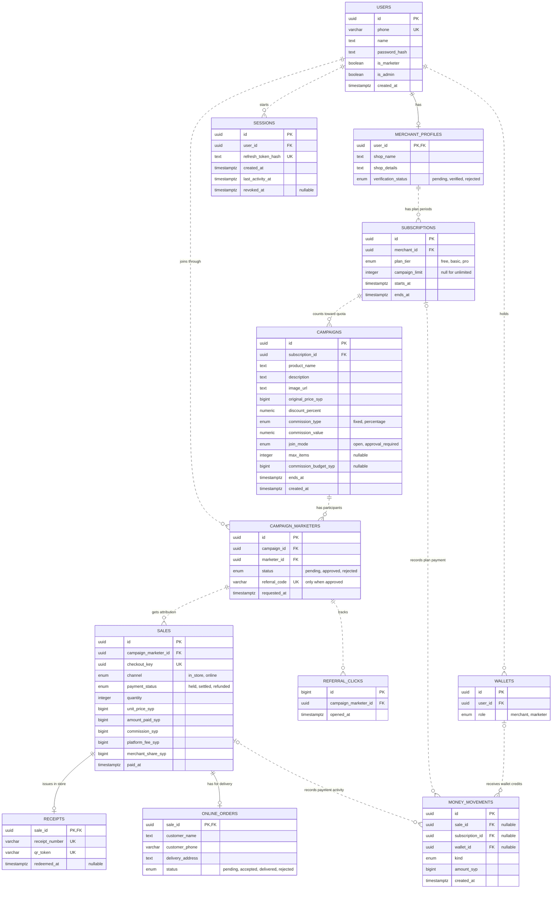

# Affiliate Marketing Platform

**Team 3 · Proposed PostgreSQL entity-relationship diagram**

One account can be both a merchant and a marketer. Each sale traces back to an approved marketer’s referral link, and online customers check out as guests.

`PK` is a primary key, `FK` is a foreign key and `UK` marks a unique column.

## Rules that go with the diagram

- **Sessions and refresh.** One user can have multiple sessions, including for admin sign-in. Initialize `last_activity_at` at sign-in. Store only the hash of the current refresh token and replace it atomically on refresh, so the old token stops working. The frontend requests refresh every 15 minutes. Protected requests check that the access token refers to a valid session.
- **Inactivity and sign-out.** Expire a session after 30 days without deliberate authenticated user activity. Refresh, polling, and background requests do not update `last_activity_at`. Explicit sign-out sets `revoked_at` and invalidates the session. The backend rejects inactive or revoked sessions even if a client still has a token.
- **Campaigns and referrals.** Only verified merchants can create campaigns within their current plan quota. Enforce one membership per `(campaign_id, marketer_id)`, block merchants from joining their own campaigns, and generate a referral code on approval. Each campaign keeps its original subscription link so its creation counts toward the right plan period.
- **Checkout and receipts.** An in-store sale settles immediately and creates one receipt. Only the campaign owner can redeem it, once. An online sale creates one order and holds the payment until the merchant accepts or rejects it. Acceptance settles the sale. Rejection records a full refund and releases the item and commission reservations.
- **Money and limits.** Store amounts in whole SYP and enforce that the three payout amounts add up to the amount paid. Lock the campaign row while checking capacity and recording payment so simultaneous purchases cannot exceed the limits. Count held and settled sales toward capacity. We propose reopening a campaign after a refund if it has capacity again and its end time has not passed.
- **Wallets and reporting.** Give dual-role accounts one wallet per role with a unique `(user_id, role)` pair. Record each payment, credit, fee, or refund as a money movement tied to either a sale or a subscription. Derive balances and the leaderboard from posted credits, and campaign statistics from clicks and sales.

Sources · *Affiliate Marketing Platform*, B4F Hackathon Team 3 project specification, and the [API contract](API_CONTRACT.md#authentication-and-account).
