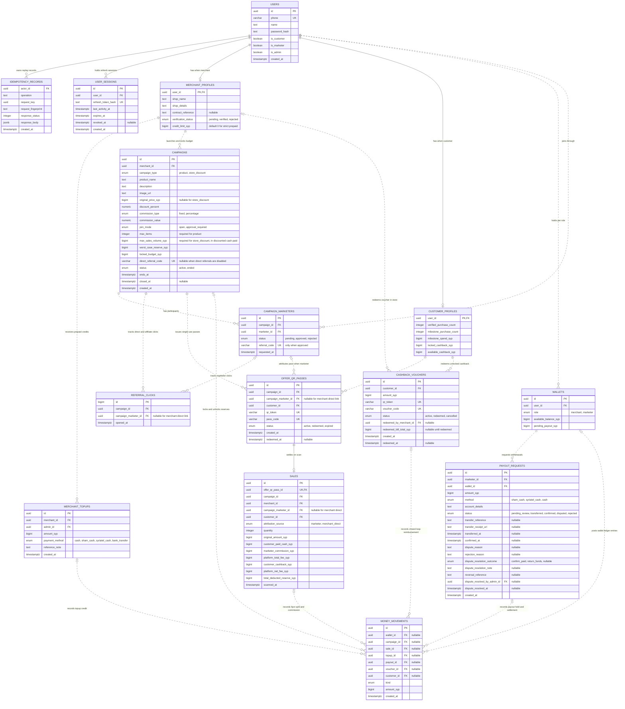

# Affiliate Marketing Platform

**Three-day demo scope.** Product campaigns only, open joining, fixed commission, and one item per sale. Demo accounts are seeded. The core flow is admin top-up, merchant campaign launch, Expo join and share, web referral and Offer QR, manual merchant redemption, commission and cashback updates, and campaign closure with reserve release. Cashback voucher redemption is the first extension. Store discounts, approval workflows, camera scanning, full marketer web, advanced reports, direct merchant referrals, and payout receipt workflows are backlog for this demo. This scope governs the hackathon. The detailed product descriptions below also cover future work.

**Team 3 · Proposed PostgreSQL entity-relationship diagram (Updated Cash-in-Store, Prepaid Reserve & Cashback Logic)**

One account is uniquely identified by a Syrian mobile number and can hold `customer`, `marketer`, and/or `merchant` roles simultaneously. Customers register once by phone to receive single-use Offer QR codes, pay cash in store, and accumulate cashback unlocked at milestones. Merchants prepay SYP balances via Admin top-ups and lock worst-case reserves per campaign. Marketers earn into one unified wallet and withdraw via Admin-verified Sham Cash transfers with receipt confirmation.

`PK` is a primary key, `FK` is a foreign key, and `UK` marks a unique column.

## Rules that go with the diagram

- **Demo reserve.** Use `max_items × (fixed_commission_syp + floor(final_price_syp × 5 / 100))` with one item per sale. For future multi-item pricing, bound percentage charges using the full discounted cap before flooring.
- **Idempotency.** Enforce uniqueness on `(actor_id, operation, request_key)`. Claim or replay the key before locking or changing business records. Commit each successful mutation with its response. For campaign launch, this commits the campaign, wallet reserve transfer, ledger movement and launch response together. Serialize concurrent retries on the unique key and replay the recorded response for an identical request.
- **Active Offer QR uniqueness.** Create a partial unique index on `(campaign_id, customer_id, campaign_marketer_id)` for active passes with a non-null `campaign_marketer_id`. A second partial unique index on `(campaign_id, customer_id)` covers active passes where `campaign_marketer_id IS NULL`. Lock the campaign before checking eligibility and reusing or issuing a pass. If an insert conflicts with the active-pass index, use conflict handling that keeps the transaction open, then load the winning active pass.
- **Monetary bounds.** Use exact integer or decimal arithmetic for pricing, ledger sums and aggregate reads. Bound persisted SYP values to `0..9007199254740991` and check resulting monetary balances before commit. Follow the [shared API limits](API_CONTRACT.md#monetary-limits-and-precision) for response conversion and error behavior.
- **Shared close.** Use one campaign service operation for explicit close, cap exhaustion and expiry. Lock the campaign first for existing-campaign mutations, then the pass when applicable and the affected balances in a consistent order. Expire outstanding active passes and return the unused reserve once with its ledger movement. A final-sale mutation stores its response after this close operation, with zero remaining locked budget.
- **Voucher liability.** Active voucher amounts are reserved customer liabilities. Voucher issuance locks the customer row and commits the debit, active voucher and idempotency result together. Redemption and cancellation lock the voucher, update its state conditionally and settle the reservation once. On redemption require the bill total to cover the voucher, store the bill total, and credit the merchant in the same transaction.

- **Accounts and sessions.** Enforce unique `phone` (`^09[0-9]{8}$`). Track refresh sessions in `USER_SESSIONS` with rotated token hashes and 30-day inactivity expiry. Only verified merchants may receive top-ups and launch campaigns.
- **Prepaid balance and worst-case campaign locking.** Give each merchant one `WALLETS` row (`role = 'merchant'`) and each marketer one `WALLETS` row (`role = 'marketer'`), unique on `(user_id, role)`. Launching a campaign computes `worst_case_reserve_syp` (all marketer commissions + 5% platform fee across `max_items` or `max_sales_volume_syp`), verifies `available_balance_syp >= worst_case_reserve_syp` under a wallet row lock, and atomically moves that amount into `CAMPAIGNS.locked_budget_syp`. When a campaign ends or is closed early, any remaining `locked_budget_syp` unlocks back into `available_balance_syp`.
- **Joining and self-promotion.** Enforce unique `(campaign_id, marketer_id)` in `CAMPAIGN_MARKETERS`. Block merchants from joining their own campaigns as marketers, and issue a `direct_referral_code` when direct referrals are enabled so the merchant can self-promote with `0` marketer commission (paying only the 5% platform fee).
- **Single-use Offer QR and atomic settlement.** A signed-in customer receives an `OFFER_QR_PASSES` entry bound to `(campaign_id, campaign_marketer_id?, customer_id)`. Only the campaign owner may scan it, inside a single DB transaction locking `CAMPAIGNS` before `OFFER_QR_PASSES`. On scan: compute `customer_paid_cash_syp`, `marketer_commission_syp` (`0` if `merchant_direct`), `platform_total_fee_syp = floor(paid * 5 / 100)`, `customer_cashback_syp = floor(paid * 2 / 100)`, and `platform_net_fee_syp = platform_total_fee_syp - customer_cashback_syp`. Deduct `marketer_commission_syp + platform_total_fee_syp` from `CAMPAIGNS.locked_budget_syp`, credit the marketer's wallet immediately, and update `CUSTOMER_PROFILES`. Automatically end the campaign at the applicable cap or expiry and release the unused reserve. For future store discounts, sum `sales.customer_paid_cash_syp` under the campaign lock. Reject a sale that would exceed `max_sales_volume_syp` and keep the pass active. If the sale reaches the cap, close and release in the same transaction.
- **Cashback milestones and closed-loop vouchers.** When `CUSTOMER_PROFILES` reaches the milestone criteria (`milestone_purchase_count >= 5` and `milestone_spend_syp >= 50000`), move `locked_cashback_syp` into `available_cashback_syp` and reset the current milestone counters. Generating a `CASHBACK_VOUCHERS` record reserves funds from `available_cashback_syp` (cancelled vouchers return it). When a verified merchant scans a voucher, deduct/finalize the voucher and credit `+amount_syp` into that merchant's `available_balance_syp`.
- **Marketer payouts and receipt proof.** In the future payout flow, requesting a payout moves funds from available to pending under a wallet lock. Pre-transfer rejection releases the hold. Recording a transfer clears pending and posts the cash outflow with its receipt and a reference unique per payment method. Confirmation, including automatic confirmation after 72 hours, and disputes update the payout state. Admin dispute resolution records the outcome, admin, note and time. On verified full reversal, log the external cash inflow and restore available funds in one transaction. Keep the original receipt. Lock the payout and any affected wallet and record each financial transition once.
- **Accounting separation.** Derive platform overview totals strictly from `MONEY_MOVEMENTS` and wallet tables so Merchant Escrow, Locked Campaign Reserves, Marketer Liabilities, Customer Cashback Pool, and Net Platform Fees never mix.
